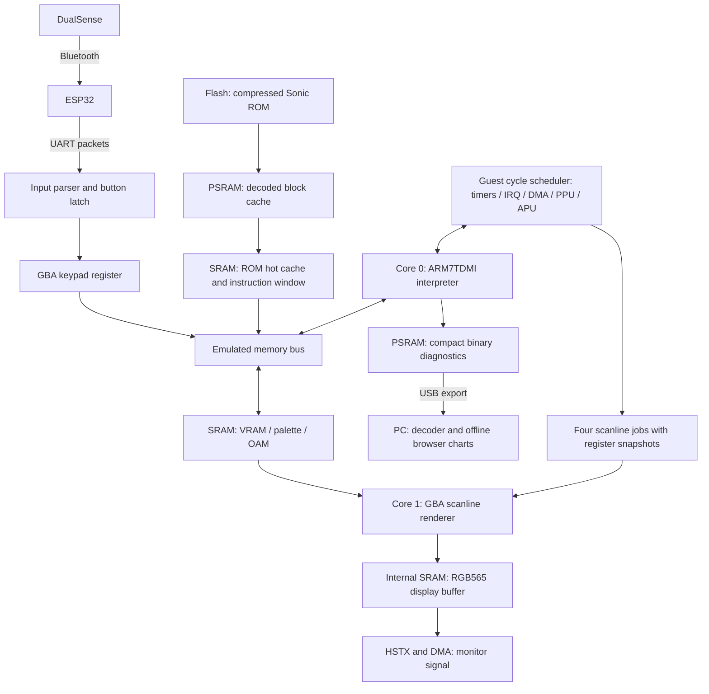

# How this GBA emulator works

This project recreates GBA hardware in software on an Adafruit Feather
RP2350 HSTX with 8 MiB PSRAM. An ESP32 receives a DualSense controller over
Bluetooth and forwards input over UART. The Feather runs the game and
generates the monitor signal through HSTX. Arduino provides the build and
board environment; the emulator itself is C++.

The latest board-measured baseline is V45; V46 is an inline-fetch/CPU-profile
board-trial candidate with unmeasured hardware FPS.
V44's predecoded blocks and V45's uncached burst default off.
The architecture below describes the system rather than claiming an untested
board speedup. See PROJECT-HISTORY.md for the complete sequence.

## A ROM supplies guest instructions, not RP2350 firmware

A GBA ROM contains code for an ARM7TDMI processor and graphics, sound and
other game data. The interpreter maintains a guest CPU state: registers,
CPSR flags, banked exception registers and the current guest cycle count.
For each instruction it fetches the opcode, decodes ARM or Thumb semantics,
performs the operation and updates that state. The RP2350 executes the C++
interpreter; it does not directly execute the cartridge's ARM7 program.

Instruction timing also matters. A load from slow external GBA working RAM
has a different guest cost from an internal-RAM load. Branches, cartridge
wait states and prefetching affect guest cycles. Those cycles drive the
emulated devices; they are not measurements of the Feather's real elapsed
time. Correctly advancing guest time does not guarantee real-time speed.

## The bus gives addresses their hardware meaning

The bus routes CPU and DMA accesses to memory or a device, applying rules
such as alignment, mirrors, ignored/replicated writes, BIOS read protection,
open-bus latches, cartridge EEPROM and ROM prefetch behavior.

| Guest region | GBA function | Storage/implementation in this build |
| --- | --- | --- |
| `00000000` | 16 KiB BIOS | Checked SRAM copy when memory permits; otherwise immutable flash view |
| `02000000` | 256 KiB EWRAM | PSRAM |
| `03000000` | 32 KiB IWRAM | Internal SRAM |
| `04000000` | Hardware registers | Emulated CPU/device state and register handlers |
| `05000000` | 1 KiB palette | Internal SRAM |
| `06000000` | 96 KiB video RAM | Internal SRAM |
| `07000000` | 1 KiB sprite attributes / OAM | Internal SRAM |
| `08000000`–`0DFFFFFF` | Cartridge ROM windows | Compressed flash asset, decoded backing cache and SRAM hot cache; peripheral exceptions retained |
| `0E000000` | Cartridge save interface | SRAM/Flash/EEPROM emulation with a reserved PSRAM save buffer |

These are guest addresses. They are translated by software and are not the
RP2350's physical memory map. Save memory currently lives in volatile RAM;
this architecture does not establish persistent save-file storage.

## How a 16 MiB ROM fits

The selected Sonic ROM is split into independently compressed 16 KiB blocks.
An index records each block's flash offset, size and CRC. The packed bytes
occupy about 4.53 MiB, allowing this particular ROM and firmware to fit the
Feather's 8 MiB flash. Compression ratios differ by game; this does not
promise that every GBA cartridge will fit.

The entire ROM cannot remain decoded in the 8 MiB PSRAM. A 6.875 MiB backing
cache holds decoded blocks and replaces them using a second-chance policy.
A smaller, two-way 32 KiB cache holds 256-byte lines in fast internal SRAM.
A separate stable 256-byte instruction window prevents ordinary data-cache
eviction from invalidating the bytes the CPU is fetching.

Consequently, most ROM reads perform cache lookups rather than decompression.
The V42 captures show only 0–17 ms of decoding per wall second, despite slow
gameplay. Cache lookup and memory access costs are separate from decoding.

## Scheduling one emulated frame

The frontend runs the emulator in slices of at most 1,024 guest cycles and
polls controller input between slices. Inside each slice, the scheduler
bounds execution by the next relevant hardware event and advances devices
to a stable guest cycle. Timers, pending interrupts, DMA, PPU scanline
events and APU timing remain coordinated.

GBA timing comprises 228 scanlines, including 160 visible lines, and 1,232
guest cycles per line: 280,896 cycles per frame. The guest clock represented
by the core is 16,777,216 Hz, giving roughly 59.73 frames per second at full
speed. The project's “60 FPS” goal refers to approximately this game rate.

At a visible scanline event, the emulator queues a rendering job. The queue
captures an 84-byte register snapshot: display mode, background transforms,
scroll, windows, blending and related state. Core 0 may then change live
registers while Core 1 finishes an older line using its captured values.

## What each RP2350 core does

**Core 0** runs the guest CPU, the bus and device scheduling. It also polls
UART, updates input, maintains the frontend, handles HDMI interrupts and
collects/export diagnostics. CPU registers, the emulator object and hot
interpreter code reside in SRAM.

**Core 1** consumes the four-entry scanline queue. It renders backgrounds
and sprites from SRAM video memory, resolves windows, layer priority,
transparency and color effects, and converts the final RGB555 row to
RGB565 directly in the display buffer. The full GBA framebuffer copy is
bypassed on this output path.

The queue does not make all accesses independent. Before Core 0 changes
shared VRAM, palette or OAM, pending jobs must finish reading the old bytes.
It also waits when all four queue entries are occupied. Acquiring/releasing
queue entries protects the snapshots and job lifetime. A frame-end drain
ensures rendering is complete before reading its counters or rebinding
the display buffer. The logged Wait value comprises Qfull plus Barrier.

## Rendering and the V42 change

The renderer supports text/affine backgrounds, bitmap modes, sprites,
windows and blending. Tile/sprite caches avoid some repeated decoding;
dirty tracking avoids re-rendering rows that can safely be reused.

For each dirty row, the renderer prepares its scratch state, draws BGs,
draws OBJs, composites the layers and writes RGB565 output. V42 resolves
window rules over spans and preselects ordered BG row pointers. Packed
layer values carry color/identity/priority together. When alpha cannot
need a second layer, a simpler kernel omits that search.

HSTX and DMA generate the monitor signal from the display buffer. They
accelerate video output rather than GBA tile/sprite rendering. The monitor
continues receiving frames while the interpreter is slow, so a stable
display signal and 7–12 new emulated game frames per second can coexist.

## Input and sound

The ESP32 uses classic Bluetooth to receive DualSense state and sends
COBS-framed, CRC-checked packets over 230,400-baud UART. The Feather validates
packets, maps input to the GBA's ten buttons and applies the active-low keypad
register state. A latch retains short presses until a guest frame can see
them, and disconnect handling releases stale input. Analog controls can
arrive in the packet, but GBA software reads its digital button interface.

Slow guest frames also delay visible response: rapid UART delivery cannot
make a game finish its next simulation/rendered frame sooner.

Audio waveform synthesis is disabled in the current build. FIFO, DMA and
other timing interactions remain, because games may depend on those events
even when no audio is output.

## Profiling real elapsed time

The binary logger stores each completed frame's timings and counters in a
24 KiB PSRAM ring. Old complete records are overwritten when it fills.
CPU samples periodically record the three most frequent host functions.
V46 additionally exports every nonzero mapped function's exact count, with
complete-window markers and contamination flags. [V46 board findings](V46-BOARD-RESULTS.md)
explain what the full distributions establish and where attribution remains
limited, including inlined fetch/ALU work inside the CPU-loop function.
USB export freezes the retained log at a frame boundary; decoding and
charting happen on the PC. Logs are volatile and should be exported before
reset.

Run includes renderer waiting and interruption on Core 0. Draw is measured
on Core 1 and overlaps Run. Draw is partitioned into Prep, BG, OBJ, Mix,
RGB and Other. Do not add Run + Draw + Wait. A 95% instruction-window hit
rate also does not prove fetching is cheap: every hit still has lookup,
bus sequencing and guest timing work.

In the slowest supplied V42 window, about 128 ms of Run includes 13.5 ms
of render waiting, leaving roughly 115 ms outside that wait. Draw is about
30 ms. This is why CPU execution/fetch is now the primary investigation,
while rendering also remains above the 16.7 ms real-time budget. The
measurements establish the gap; they do not establish a proven path to
60 FPS on this board.

V44 adds an optional, timing-preserving Thumb ALU block predecoder. It still
interprets fetched instructions and does not generate native code. It
defaults off after a host regression; details and board A/B commands are in
[PERFORMANCE-v44.md](PERFORMANCE-v44.md). See the
[render optimization map](RENDER-OPTIMIZATION-MAP.md) and
[physical memory layout](MEMORY-LAYOUT.md) for the remaining opportunities.

V47 adds CPU-only fixed-width RAM-read and bounded BIOS-fetch leaves, plus
32-bit packed flag calculations. The RAM path preserves guest bus timing and
latches; it does not turn external EWRAM into SRAM or bypass device events.
Its runtime memory switch restores the older read/fetch routes for board A/B;
packed flags remain active until the full V46 firmware is restored. The
[V47 report](PERFORMANCE-v47.md) records correctness checks and mixed host
timings. These changes do not implement native translation.
