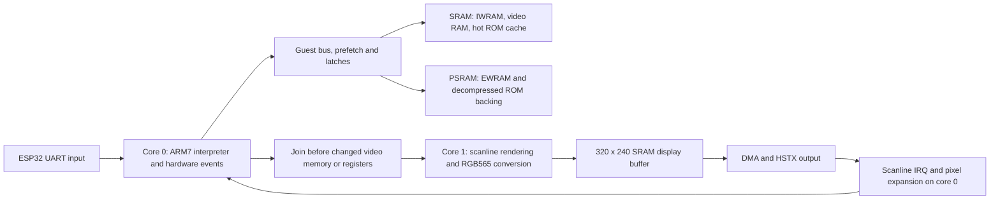

# Performance investigation while v33 is on test

Date: 2026-10-19. ROM: Sonic Advance 3 (Europe). Board configuration:
Feather RP2350 HSTX, 240 MHz CPU, 30 MHz PSRAM, 8 MiB PSRAM, original
user-supplied BIOS. V33 has now been tested on the board: submit 22%,
code fetch 12%, CPU dispatch 8%, Wait 24 ms/frame. FPS/Run/Draw/IFetch,
scene and duration remain unspecified, so a v33 speedup is unmeasured.

## Finding

The strongest supported diagnosis is a **core-0 execution critical path,
interrupted by HDMI and blocked by shared-state rendering barriers**. Both
cores already run useful work, but their work cannot overlap freely. There is
no evidence that merely enabling the second core, enlarging a queue, or
removing ROM decompression will yield the roughly eightfold gain needed to
move a 7 FPS scene to 60 FPS.

The exact split between interpreter instructions, memory stalls and event
handling still needs board counters. A PC sample identifies the interrupted
function, including time spent stalled or waiting; it does not establish
CPU utilization or memory-bandwidth utilization.

## Existing execution and memory layout

Core 0 runs the guest CPU, timers, DMA, PPU timing, silent audio state and
UART polling. Core 1 renders the current scanline and converts it directly
into the display buffer. There is one renderer workspace and one pending
job in v33. Core 1 sleeps when no job is available; core 0 sleeps while
waiting for it. Waiting consumes elapsed time without necessarily consuming
instruction-execution capacity.

Every subsequent scanline submission joins the previous job. Actual changes
to VRAM, palette, OAM or render-visible registers also join it. Equal-value
writes already bypass most joins. Removing these barriers without preserving
the old data would let core 1 render with a mixture of different guest times.

The final v33 ELF places the main interpreter, bus read/code-fetch paths,
scanline renderer and worker in SRAM. For example, `execute_thumb` is at
`0x20002fe4`, `execute_arm` at `0x20004404`, and `render_scanline` at
`0x20008ad8`. Moving those same functions into SRAM again is not an available
improvement. Some helpers, including `apply_shift`, remain in flash and merit
measurement before selective placement changes. V29's failed placement bundle
is not a validated basis for another broad relocation.

The fast bus storage is 133184 bytes and the ROM hot cache is 32768 bytes.
IWRAM, VRAM, palette and OAM are in SRAM. Large EWRAM and decompressed ROM
backing remain in PSRAM. The v33 initialized RAM image is 50620 bytes,
static SRAM is 230356 bytes, and the emulator object is 83456 bytes.
Heap capacity before dynamic allocations is 277548 bytes; this is not free
heap after the display, emulator, BIOS and other allocations are live.

## What the existing board measurements establish

The latest complete comparable set available before this investigation is
the user's v30 reading: 5–7 FPS, Run 113, Draw 30, Copy 0, Wait 32 ms/frame,
31507 HDMI IRQ/s and 146 handler ms/s. Later v32 samples report submit 22%,
code fetch 11%, Thumb execution 7%, CPU dispatch 8%, Bad 0 and unmapped 36,
with window alignment and total N unspecified.

* Run includes renderer waits and interrupts. Draw runs on the other core.
  Adding Run + Draw + Wait double-counts overlapping time.
* In that v30 window, subtracting Wait leaves about 81 ms of Run. Even
  eliminating all 32 ms of Wait would improve the Run component by at most
  `113 / 81 = 1.40x`, assuming everything else stayed fixed. It is not a
  prediction of total FPS.
* 146 handler ms/s occupies 14.6% of one core's elapsed wall time. An ideal
  removal of only that cost gives about `1 / 0.854 = 1.17x` throughput under
  a constant-work model. IRQ entry/exit and nonlinear effects are outside
  this estimate. HDMI work is worth fixing, but cannot alone supply 8x.
* `submit_hook` contains an inlined WFE wait in the ARM disassembly. Its
  sample percentage is not evidence that pushing a queue item costs 22%.
* The dependent-load measurements were SRAM32 = 21 ns, PSRAM32 = 767 ns,
  PSRAM256 = 1188 ns. Those are this benchmark's dependent-loop averages,
  not a whole-program stall percentage or a sustained streaming bandwidth.
* Zero ROM decode ms/s rules out decompression as the current window's
  dominant work. It does not rule out PSRAM reads, guest-bus overhead or
  flash/XIP stalls. Cold scenes can still incur decompression spikes.

## Controlled experiments completed

All changes live in `../build/pipeline-study`, a private extraction of the
frozen v33 source ZIP. Production v33 source and UF2 are unchanged. The
runner uses the existing compressed Sonic data, original BIOS, scripted
input, direct RGB565 output and 1024-cycle frontend slices. Each timing run
warms up for 1200 frames, then measures 2400 frames; each mode is repeated
three times sequentially. No compilation runs alongside a timed trial.

Three modes separate guest work from rendering:

* `compute`: execute the guest with rendering disabled, for diagnosis only.
* `inline`: render the same rows and convert RGB565 synchronously.
* `thread`: run the renderer in a separate host thread.

These are **Windows/MSVC host elapsed times**, not RP2350 FPS or core
utilization. The host has different caches, memory latency, instructions and
thread scheduling; `yield()` is not the board's WFE. Small differences need
board confirmation. The diagnostic no-render mode is not a proposed playable
optimization and is excluded from correctness claims about video.

| Variant | Compute median, ms | Inline median, ms | Thread median, ms | Thread speed ratio to v33 model |
| --- | ---: | ---: | ---: | ---: |
| Existing one-job worker | 1038.683 | 1928.349 | 1737.684 | 1.000 |
| Four queued jobs | 1045.873 | 1871.532 | 1639.899 | 1.060 |
| Four jobs + one-pass schedule refresh | 1001.406 | 1845.588 | 1631.148 | 1.065 |
| Sixteen jobs + one-pass schedule refresh | 1004.055 | 1882.414 | 1637.671 | 1.061 |
| Four jobs + schedule + silent-event coalescing, REJECTED | 886.832 | 1760.220 | 1585.122 | 1.096 |

The raw repetitions, ranges and counters are in
`deep-performance-study.json` (local/private reference: `output/deep-performance-study.json`).
Five variants × three modes × three repeats = 45 timed trials.

### Queue result: synchronization limits the benefit

The experimental worker uses a bounded single-producer/single-consumer ring.
The producer publishes complete jobs with release ordering; the consumer
releases a slot only after rendering and updating elapsed time. The consumer
owns dirty-state checks. Clean duplicate jobs never copy stale row pixels.
All existing changed-state barriers still drain the queue. Display target
replacement drains it before the old storage can be freed.

Four jobs reduce host elapsed time by about 6%. Sixteen jobs do not improve
on that. With one-pass scheduling, queue-full wait changes from about 439 ms
at depth four to 298 ms at depth sixteen, while barrier wait rises from about
132 to 284 ms over the measured interval. Much of the wait moves to another
location instead of disappearing. The intervals have about 36000 blocking
barrier waits for 2400 frames, around 15 per frame. Queue-full waits remain
because the producer can rapidly reach subsequent scanlines while the
consumer is still working.

The ARM compiler measures the baseline worker object at 536 bytes, four
jobs at 648 bytes (+112), and sixteen at 1080 bytes (+544), without host-only
counters. The smaller queue is the reasonable initial board candidate.
These are object-size measurements, not a fully linked firmware memory map.

Both the four-job worker and final sixteen-job/scheduler combination pass
6000 frames against the conservative synchronous original-ROM reference:
full CPU/banked/flag state, exact cycles, bus/prefetch/latches, EWRAM, IWRAM,
every RGB565 pixel and protected margin, and display target replacement at
frame 3000. The final result remains PC `080bc248`, frame hash `5ba30470`,
1685293130 guest cycles and 953015 rendered scanlines. Focused tests cover
forced blank, clean/duplicate jobs, ring wrap and pending-job target detach.

### Event refresh: repeated small work is real

The normal measured interval makes 3864359 CPU/event slices and schedule
refreshes, about 1610 per frame, and 4214931 hardware service passes. Each
refresh previously updated six slots through six separate setters that can
recompute the earliest event. The experiment assigns all six deadlines and
reduces the minimum once. Event values and ordering are preserved.

This improves the compute-only host median by roughly 4% relative to the
baseline. Its additional benefit with rendering is small. It merits a board
trial, but cannot plausibly be the entire performance gap.

### Silent sample events: promising work reduction, rejected implementation

Even with waveform synthesis disabled, the current APU schedules sample-only
events every 512 guest cycles. An experiment advanced silent sample phase
arithmetically while retaining frame-sequencer and FIFO state. It reduced
CPU/schedule slices from 3864359 to 2591545 (about 33%) and hardware passes
from 4214931 to 2940960 (about 30%).

Randomized guest-visible audio register/FIFO comparisons passed, and final
3600-frame probe hashes happened to match. However, the stricter sliced
reference test failed **exact cycle parity**. It is rejected and removed
from the surviving study candidate. Its faster timing is not an accepted
emulator result.

The CPU resets its sixteen-instruction hardware-service countdown at each
`cpu_run_until` entry, and instructions can cross a scheduler deadline.
Those are concrete reasons to audit sensitivity to added/removed event
boundaries; the exact cause of this failed case has not been isolated.
Correctness requires a timing redesign or a proof of equivalent service
points before dropping these events. Changing a test to compare only final
pixels would conceal this problem.

### Guest work remaining after idle-loop acceleration

The validated 6000-frame study also sampled guest PCs once per 257 executed
instructions. Of 439912 samples, the 16-byte Thumb block at `080bc1e0`
accounts for 21.21%. Inspection identifies the DISPSTAT VBlank polling path,
including the already accelerated five-instruction wait. Event-boundary
tails and stability checks still execute real iterations; the profile does
not prove a missing new loop pattern.

Four blocks around `08093410`–`08093490` together account for about 17.25%.
They contain real arithmetic, comparisons, loads and halfword stores in a
160-iteration loop. They are not a read-only polling loop. Skipping them
would change game state. These percentages describe guest instructions in
this scripted workload, not board wall-time shares or every gameplay scene.

## How to use more of the RP2350 effectively

### 1. Measure core 1 and the bus before assigning more work

Add a second-core sample stream or cycle counters around actual renderer
work and idle periods, along with queue-full waits, mutation-barrier waits,
job count and queue high-water mark. Report intervals on both cores against
the same wall-clock window. Keep render work, WFE idle and IRQ occupancy
separate. A busy-looking core-0 PC profile cannot answer what core 1 is doing.

Use the four hardware bus counters to rotate through SRAM banks and the two
XIP downstream ports. Each selected port exposes accesses, contested accesses
and upstream/downstream stalls. Counters are 24-bit saturating, initially
disabled, and cleared by a write. At one event per 240 MHz cycle, saturation
takes about 69.9 ms: target 10 ms windows, reject saturated or excessively
delayed windows, and retain actual elapsed time. Polling from a long-running
main-loop operation alone cannot guarantee a valid sample interval.

The installed SDK has an older compatibility enum whose selector values
do not match the RP2350 register definitions. Use explicit
`BUSCTRL_PERFSEL0_VALUE_*` macros from the RP2350 register header. The
`SIOB_PROC0/1` selectors describe those downstream ports, not each CPU's
total stall time. Port counters are aggregate traffic and must not be
presented as per-core utilization. [RP2350 bus-counter definitions](https://github.com/raspberrypi/pico-sdk/blob/master/src/rp2350/hardware_regs/include/hardware/regs/busctrl.h)

Collect XIP cache hits and accesses in the same bounded windows. These
counters are 32-bit saturating and clear on write; the access count includes
noncacheable accesses. Thus `1 - hits/accesses` is an unserved-from-cache
fraction for the observed traffic, not automatically a cacheable miss rate
or CPU stall fraction. [RP2350 XIP definitions](https://github.com/raspberrypi/pico-sdk/blob/master/src/rp2350/hardware_regs/include/hardware/regs/xip.h)

### 2. Offload HDMI scanout setup and expansion to DMA

The installed Arduino HSTX driver already uses hardware TMDS encoding and
DMA, but a highest-priority interrupt still prepares each physical line.
For this 320-pixel RGB565 mode, it reads pixels and duplicates them into
640-pixel line buffers in CPU code. The measured rate is about 31500 IRQ/s.

CircuitPython's RP2350 backend demonstrates a different arrangement: a DMA
command channel programs a pixel channel, narrow transfers duplicate pixels,
and the CPU handles frame boundaries. This is the concrete scanout-offload
direction to prototype. Its command list at the equivalent doubled
640×480 timing is `(45 + 2*480 + 1)*4*4 = 16096` bytes before other objects.
Replacing the existing roughly 5 KiB line buffers offsets some of that cost.
The live SRAM budget must be checked before integrating a direct port.
It is not a drop-in Arduino API replacement and has not been implemented
here. [Adafruit's DMA-command backend](https://github.com/adafruit/circuitpython/blob/main/ports/raspberrypi/common-hal/picodvi/Framebuffer_RP2350.c)

Moving the existing HDMI interrupt to core 1 is another experiment, with a
tradeoff: it may preempt rendering and increase core-0 waits. Display restart
must first pause/acknowledge the owning core and disable its IRQ before
freeing buffers. The existing core-0 `display.end()` path alone does not
provide that cross-core lifetime handshake.

### 3. Reduce guest CPU and bus cost

V33's stable SRAM instruction line already removes repeated provider/cache
lookups on eligible sequential fetches. Its board hit ratio and new profile
will determine the next target. Preserve guest prefetch state, open-bus
latches, waitstates, aliases, EEPROM/GPIO exclusions and DMA ordering when
specializing more fetch/read/write cases.

The larger architectural option is decoded basic blocks or dynamic
translation: avoid repeated opcode classification and repeated generic
bus work. Start with immutable ROM blocks and explicit exits for event
deadlines, branches, IRQs, memory effects and exceptions. RAM code requires
invalidation on CPU/DMA writes. Translation also needs a bounded SRAM
budget and conservative fallback. It is a substantial interpreter change,
not a ROM compression change or an existing acceleration feature to enable.

Selective native BIOS routines could also remove interpreted work, but the
current partial HLE path is not a proven substitute for the working original
BIOS. Routine-level profiling and register/flags/memory/timing equivalence
come before enabling it. Do not force the old HLE path globally.

### 4. Decouple rendering only with an explicit data-ownership design

A larger job ring still shares mutable PPU registers, video memory, dirty
flags and caches. To render further behind the CPU, it would need immutable
per-job state and pinned/copied dependencies, or a separate video snapshot
plus ordered writes. Another complete VRAM/palette/OAM snapshot is about
100 KiB; it does not fit the remaining SRAM casually, and PSRAM copies and
random reads introduce new costs. A tile/row snapshot design is worth
exploring after core-1 and bus measurements establish its likely benefit.

The guest ARM7 instruction stream itself is sequential; its next instruction
cannot simply be sent to the other CPU concurrently. The useful partition
is guest execution, rendering and hardware scanout with fewer dependencies.
RP2350 provides DMA, HSTX and interpolators/DSP-capable Cortex-M33 cores,
but no general GPU. These peripherals can assist data movement and suitable
pixel/address operations; they do not execute ARM7 guest semantics.
[RP2350 hardware features](https://www.raspberrypi.com/products/rp2350/)

## Trial order and acceptance criteria

1. Finish the user's v33 measurement on one named slow screen: sustained
   FPS, Run/Draw/Wait, HDMI handler ms/s, IFetch hit/fills and PC0 samples.
2. Trial the four-job queue and one-pass schedule refresh separately or as
   explicitly identified variants, retaining the frozen v33 fallback.
3. Add core-1 busy/idle and bus/XIP observations; compare complete windows
   on the same screen with the same controller state and clocks.
4. Prototype command-DMA HDMI separately, verifying restart, pin mapping,
   timing, framebuffer lifetime and SRAM headroom before combining changes.
5. Address the largest measured remaining CPU/bus or render function; keep
   exact reference comparisons and add a workload that exercises gameplay.

Do not count display refreshes, skipped rendering or dropped game frames as
60 emulated FPS. No new board FPS gain or 60 FPS capability is established
by this investigation. The safe experiments show incremental room, while a
large gain requires changing the execution/ownership model rather than
merely keeping both cores busy.

## Evidence and preservation

* `../build/pipeline-queue-regression.log`: four-job 6000-frame parity.
* `../build/pipeline-queue16-regression.log`: final scheduler/queue parity
  and guest instruction profile.
* `../build/pipeline-mute-regression.log`: rejected silent-event cycle failure.
* `../build/pipeline-*-results.json`: all native timing repetitions.
* `../build/pipeline-study`: surviving private experimental source, depth
  sixteen plus one-pass scheduling; original APU timing restored.
* `../build/layout-{v33,queue4,queue16}.o`: ARM worker-size evidence.
* 85 files from the frozen private v33 source ZIP were verified byte-for-byte
  against production. V33 UF2 SHA256 remains
  `ccbceddca8f08cee038d9d05172e477ac696d1f1c924a7e972e4463a56cf1a2b`.

This investigation initially produced no v34 firmware and preserved v33.
After the user's v33 report, a separate v34 queue/scheduler board trial was
prepared; see `PERFORMANCE-v34.md` for that subsequent build. No board was
flashed and no core, ROM, BIOS or private source archive was published.
