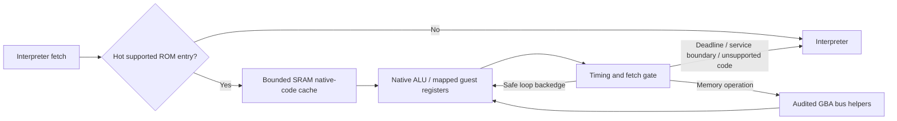

# V48: native hot-block translation

V48 adds an experimental **Thumb-to-Cortex-M33 native translator**. This is
generated machine code executed from internal SRAM, rather than the earlier
disabled predecoded-instruction experiment. The interpreter remains the
fallback. Sonic Advance 3, the selected local BIOS, 240 MHz system clock,
30 MHz PSRAM, controller UART and renderer are retained.

This document distinguishes correctness checks, local instruction-work
measurements and board FPS. **No V48 board speedup or 60 FPS result has been
measured at initial packaging.** Subsequent V48 board logs show continuing
execution with black HDMI and an abnormal video IRQ rate. See the
[V49 investigation](PERFORMANCE-v49.md). V47's confirmed slow gameplay
remains 7.59 FPS.

## What the translator does

1. Observe repeated entry PCs in ordinary cartridge ROM. A small heat table
   admits an entry after three misses rather than compiling every cold opcode.
2. Decode a bounded sequence of up to 16 supported Thumb instructions. Stop
   at a branch or unsupported instruction. Emit Cortex-M33 Thumb-2 code;
   shorten the prefix if code capacity or literal reach would be exceeded.
3. Keep guest r0–r7 in host callee-saved r4–r11 while the block runs. Native
   arithmetic updates hardware NZCV flags; flags and registers are committed
   when the block exits. The generated function preserves the host ABI and
   maintains an eight-byte-aligned stack.
4. Execute common byte/halfword/word loads and stores through the existing
   audited bus helpers. Preserve unaligned rotations, signed loads, open bus,
   video-write barriers, MMIO, DMA and guest cycle costs. Register shifts and
   multiplication also retain their ARM7 internal-cycle behavior.
5. Translate conditional and unconditional branches. A backedge to the block's
   own entry can remain inside native code, keeping guest registers live;
   service/deadline gates still bound execution. The recognized VBlank polling
   branches stay on the interpreter path so existing idle acceleration remains
   available.
6. Batch fetch checks over pure ALU sequences, where register/flag results
   cannot affect the next instruction fetch. Execute exactly the permitted
   prefix. A fetched opcode that crosses a deadline or meets DMA is retained
   and executed once after native state is committed; it is not fetched twice.



## Avoiding repeated opcode reads safely

Providers explicitly declare whether their ROM bytes remain immutable until
replacement. The owned memory provider and compressed firmware ROM opt in;
arbitrary providers default to **false**. Replacing a provider increments the
cartridge's code generation and invalidates translated blocks on their next
entry.

For eligible immutable ROM, a translated block already contains the opcode.
A specialized fetch leaf uses those bytes while maintaining the same guest
prefetch-buffer, wait-cycle and bus-latch transition. It avoids another ROM
instruction-cache lookup and load. Unusual states, nonsequential/hint edges,
disabled prefetch, unsupported regions and mutable providers keep the ordinary
fetch path. Mutable providers validate fetched opcodes and leave a block if
the code changes.

This removes host work; it does **not** remove guest fetch cycles. Physical
ROM/cache hit counters now describe the remaining actual reads, so compare
them alongside the JIT counters rather than treating their denominator as all
executed instructions.

## Memory budget and profiling

The variable-length native code pool is **2,304 bytes**, with 16 two-way cache
descriptors and a bounded admission table. It shares a union with the old
disabled decoder cache. A compile-time assertion requires the complete native
cache to fit that existing 3,328-byte budget. It introduces no large heap
allocation or PSRAM code cache.

The pool wraps and invalidates whole overlapping blocks before reuse.
Compilation and execution occur on core 0; newly written code is published
with DSB/ISB before execution. Generated blocks do not migrate to core 1.
The M33 requirement is documented in [Arm's Cortex-M33 guide](https://documentation-service.arm.com/static/66be2153882fec713ef49e49).

The emitted code, timing/fetch gate and ordinary bus/interpreter hot paths
remain in SRAM. Admission/compilation, the small typed-operation dispatch shim
and the old disabled decoded-block routine use cached flash. This avoids
silently displacing the existing BIOS SRAM copy. Final linked static SRAM is
**246,960 bytes**, versus 247,092 in V47. The linked heap budget after accounting
for the larger Emulator object improves by 116 bytes; actual free heap and
`BIOS SRAM COPY` still require confirmation on the board.

Generated SRAM code has no static ELF function symbol. The native-PC sampler
classifies its addresses under the `gba_native_translated_code` marker, using
the exact final map. Timing helpers and bus routines retain their own samples.
Frame flag **512** records whether native execution is enabled. The USB status
reports cumulative lookups, compilations, block calls, translated instructions,
memory operations, pending exits and opcode mismatches. A block call may
execute multiple loop iterations; counters can wrap as unsigned 32-bit values.

## Local performance investigation

Correctness alone did not justify enabling this backend. An additional
freestanding benchmark compiles the real CPU/bus core for Cortex-M33 and runs
both interpreter and generated code in Unicorn. It counts **executed host ARM
instructions**, with identical final guest registers, flags and cycles.

The first per-instruction gate design consumed 9.69% more instructions on the
register loop and 6.34% more on the mixed RAM loop. Batching alone was still
insufficient. Native loop branches, broader ALU support and the immutable-opcode
fetch path reduced the repeated work substantially.

The final retained local measurement is:

| Workload | Interpreter ARM instructions | Native ARM instructions | Change |
| --- | ---: | ---: | ---: |
| Register/ALU loop | 11,917,781 | 7,409,259 | **−37.83%** |
| Mixed ALU and RAM loop | 11,972,241 | 8,481,122 | **−29.16%** |

These are two synthetic warm-loop workloads. Instruction counts are **not
CPU cycles, elapsed speedups, game FPS or evidence of a 60 FPS result**.
Unicorn does not model RP2350 PSRAM/XIP stalls, HDMI interrupts, memory
contention or the board's instruction timings. Cold compilation and the real
game's translated coverage can change the outcome. The retained report is
`build/gba-host/native-v48-arm-work.json`.

## Validation and debugging

The native test harness executes the actual emitted Thumb-2 byte stream in
Unicorn and calls the real host core for timing and bus helpers. It checks
ABI preservation as well as guest registers/flags, exact cycles, RAM, video
memory, prefetch/latches, IRQs and DMA channel state. Fixtures exercise all
low-register ALU families, memory widths, signed and unaligned loads,
mirrors, MMIO, ROM/open bus, short deadlines, cache replacement and provider
changes. Runtime native off/on transitions are also checked.

The final emitted-code audit passes **4,130 fixtures and 115,276 slices**,
including oversized-block prefix fallback. It executes 871,039 translated
instructions and 38,725 memory operations in the ordinary fixtures. The two
separate mutation fixtures verify generation invalidation and deliberately
trigger two mutable-opcode mismatches; immutable fixtures report zero.

One regression exposed prefetch advancement after a deadline had already
been reached. The batch gate now checks the deadline and service boundary
before advancing that state. Another development issue belonged to the host
test harness: repeated Unicorn code-cache invalidations caused long Windows
runs to fail. Periodically recreating its ARM execution engine bounds that
cache and allows the long tests to complete. This is separate from RP2350
firmware fault recovery.

The longer 6,000-frame Sonic test exercises the translator's real admission,
cache, timing and exit logic with a host semantic body, comparing every frame
against the original-ROM interpreter. It is distinct from the actual emitted
ARM replay. Keep the final reports in `build/gba-host/` with their scopes:

- `native-v48-audit.json`: emitted-code fixtures and deliberate mutation tests.
- `native-v48-game.json`: actual emitted-code Sonic replay; reports its frame count.
- `sonic-v48-model.log`: 6,000-frame control/timing replay and video comparison.
- `core-v48-audit.log`: existing CPU, bus, DMA, timer and rendering audits.
- `native-v48-arm-work.json`: synthetic ARM instruction-work comparison.

The replay is deterministic boot/menu/input coverage, not proof of arbitrary
gameplay compatibility. Final firmware size, stack frames, hashes and map
fingerprint are recorded in `output/performance-v48-summary.json` after packaging.

The final actual-code Sonic replay passes **1,200 frames**, executes **6,874,607
translated instructions** and **1,413,090 memory operations**, with zero opcode
mismatches. The separate 6,000-frame control/timing replay matches all twenty
V47 checkpoints, final PC `080bc248`, pixel hash `5ba30470` and guest cycle count
`1685293130`. It also checks 953,015 worker scanlines and the display-target
replacement. The two replay methods must not be combined into a claim that
6,000 frames executed through the actual generated machine code.

The final ARM map has **1,058 ranges**, fingerprint **1963911954**. The largest
individual translator stack frame is **1,496 bytes**, with a 16 KiB core-0 stack;
this is an individual-frame measurement, not a measured whole-stack peak.

## Board trial and fallback

Candidate: `output/GBAFeather-Sonic-v48-USB.uf2`. The HDMI header shows **v48**
and **J1** when native execution is enabled; J0 selects the interpreter.
No board was flashed as part of the local validation.

After flashing, use the same slow scene for native **on → off → on** captures:

```powershell
python <workspace>/GBAPrototype/tools/block_control.py --port COM9 --engine native --mode status
python <workspace>/GBAPrototype/tools/debug_log.py --port COM9 --output sonic-v48-native-on --open
python <workspace>/GBAPrototype/tools/block_control.py --port COM9 --engine native --mode off
python <workspace>/GBAPrototype/tools/debug_log.py --port COM9 --output sonic-v48-native-off --open
python <workspace>/GBAPrototype/tools/block_control.py --port COM9 --engine native --mode on
```

Allow gameplay to run long enough to replace the retained log window after
switching modes. Commands apply at completed-frame boundaries. Save status
before and after each window if you want compilation and coverage deltas.
Close Serial Monitor while using these commands. COM9 is the development
machine's current Feather port; use the port assigned to your board.

`native off` selects the interpreter in this image and resets the shared code
cache. Enabling the old block or ALU-burst experiments also disables native
execution. The unchanged **V47 UF2 is the complete firmware fallback**.

## Remaining limits and next steps

The translator covers supported **Thumb code in ordinary ROM**. ARM-state
code, BIOS/IWRAM execution, high-register operations, stack/multiple transfers,
SWIs and other unsupported instructions continue through the interpreter.
It does not translate every game instruction or link arbitrary blocks.
The small SRAM code cache may still churn in a large working set. Core 1's
background/composition cost and HDMI interrupt cost are not fixed by this work.

The next decision must use matched board logs: FPS and Run outside waits,
native coverage/compilation rates, the translated-code/fetch-helper sample
shares, free heap and rendering timings. Extend coverage or code retention
only where those measurements justify the memory and correctness cost.

The user supplied [Copetti's GBA architecture analysis](https://www.copetti.org/writings/consoles/game-boy-advance/)
during this work. Its Sonic Advance 3 layer illustrations are useful context
for the parallel renderer review; they are not measurements of this emulator.
Modified core code, supplied ROM/BIOS assets and game-containing firmware
remain private local files under the existing publication boundary.
