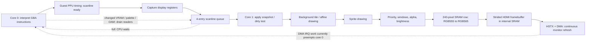

# Where the render pipeline can improve

This is a source and measurement review of V42/V43, with the V44 experiment
described separately in PERFORMANCE-v44.md. The measurements below come from
the retained V42 board logs, not from a desktop FPS prediction.

The two cores overlap work. **Run includes renderer Wait and HDMI IRQ
preemption; Draw happens on core 1. Do not add Run + Draw + Wait.** A low
average core-1 workload does not rule out bursts that fill the queue.

## A concrete slow capture

`sonic-v42-2026-10-19_23-54-42-725.bin` retains 351 frames at weighted
7.78 FPS, approximately 128.6 ms of wall time per frame:

| Measurement | Mean ms/frame | Interpretation |
| --- | ---: | --- |
| Run | 122.16 | Core-0 elapsed execution region, including waits/IRQs |
| Draw | 24.09 | Core-1 render jobs, overlapping Run |
| Background drawing | 9.48 | 39.3% of Draw |
| Layer compositing / effects | 9.95 | 41.3% of Draw |
| Sprites | 1.09 | 4.5% of Draw |
| Register/workspace preparation | 1.74 | 7.2% of Draw |
| RGB conversion / framebuffer write | 1.53 | 6.4% of Draw |
| Other render job work | 0.29 | 1.2% of Draw |
| Queue-full wait | 10.79 | Most of the 10.99 ms total Wait |
| Barrier wait | 0.20 | Includes memory/frame drains; not a separate pixel cost |

HDMI IRQ time is about 148 ms per wall second, or 14.8% of one core's
elapsed time. ROM decoding is only 0.86 ms/s in this capture. CPU dispatch
and generic instruction fetching each lead the retained CPU profile windows
at roughly 19%; these are sampled PCs, not an exhaustive time partition.
Other captures have different scenes: Draw ranges roughly 16–33 ms/f.

Even eliminating all 10.99 ms of renderer waiting, with other work unchanged,
would only reduce this 128.6 ms frame to about 117.6 ms (about 8.5 FPS).
This is a limited hypothetical, not a prediction: removing a stage can also
change memory contention and CPU timing. It demonstrates why rendering
alone cannot bridge this capture to 60 FPS.

## Opportunities, ordered by what the evidence supports

| Area and source | Change worth testing | Expected scope and limit |
| --- | --- | --- |
| `src/core/ppu.cpp`: `composite_span` | Separate opaque/no-effect spans from alpha/brightness paths; specialize common layer counts and object presence; avoid finding a second layer when it cannot contribute | Directly targets roughly 41% of Draw in this capture. V42 already sorts layers and splits constant window spans. More specialization trades SRAM code size for fewer pixel branches. |
| `src/core/ppu.cpp`: `render_text_bg`, `render_affine_bg` | Measure tile-cache collisions; cache colored tile rows with palette generations; specialize aligned eight-pixel runs and simple affine transforms | Targets roughly 39% of Draw. Index caching already exists. Colored caches need palette invalidation; affine fast paths must preserve wrap, transparency and clipping. |
| `src/core/render_worker.cpp`: `submit_hook`, `run_one` | Reduce per-job bookkeeping and wakeups; identify the scanlines that fill the queue; compare queue capacities with the same replay | Reducing Draw service time is more useful than adding queue slots blindly. A deeper queue cannot fix a sustained renderer deficit, and memory writes can drain it anyway. |
| `src/core/bus.cpp`: `write_video_memory`; PPU dirty tracking | Track which output rows depend on changed tiles/maps/OAM; avoid redrawing unaffected rows | Current changed writes conservatively dirty all scanlines, although tile-cache invalidation is more selective. Scrolling, affine transforms, old/new sprite bounds, palette and raster register changes complicate correctness. |
| Shared video memory | Versioned pages or a bounded write journal allowing the renderer to read earlier video-memory versions | This can reduce joins, but measured barrier time is currently small. It needs ordering for CPU writes, DMA and scanline snapshots, not just a second pointer. |
| `render_worker.cpp`: RGB loop | Fuse conversion into output stores where profitable; test aligned paired stores | About 1.53 ms/f here, so a secondary target. Full-frame copy has already been removed. RGB timing includes writes to the internal-SRAM display buffer. |
| `GBAFeather.ino`: video IRQ wrapper / display driver | Reduce interrupt service work or test routing video IRQ handling to core 1 | Could free core-0 execution time. Moving the same work does not remove it; it competes with drawing on core 1 and requires coordinated recovery and IRQ initialization. Video IRQ handling is currently initialized on core 0. |
| CPU interpreter / bus | Reduce dispatch/fetch bookkeeping; investigate longer translated blocks and instruction/data locality | Necessary alongside rendering. The first bounded predecode experiment passes correctness tests but regresses desktop time; caching short operations alone is insufficient. |

## Why an independent VRAM copy is not automatically faster

The queued jobs already own their display-register snapshot. Their VRAM,
palette and OAM spans still refer to shared live arrays. Changed writes drain
the queue before modifying those arrays, preserving the older lines' view.

A full independent video-memory image needs 96 KiB VRAM + 1 KiB palette +
1 KiB OAM = **98 KiB per image**, before registers or metadata. The current
internal SRAM heap has only about 20 KiB free in V42, and less with a block
cache. The PSRAM arena also has only about 7 KiB spare after logging, so a
new image requires repartitioning (for example, reducing the ROM cache).
Putting the renderer's whole working image in PSRAM would replace fast SRAM
pixel/tile reads with slower external accesses. A bounded copy-on-write
design might be better, but needs measurement and overflow fallback.

Full images per scanline or blindly copying 98 KiB per job are poor fits.
This is an architectural experiment with memory and correctness costs, not
a demonstrated fix for the current approximately 0.2 ms/f barrier cost.

## What has already been removed or reduced

- Rendering already uses native GBA 240 x 160 pixels. HDMI does not ask the
  emulator to redraw the game at a larger resolution.
- The full-frame RGB copy is bypassed: a 240-pixel SRAM row is converted
  directly into the strided display buffer.
- Immutable register snapshots allow CPU register writes to overlap queued
  drawing. Changed video-memory writes still synchronize.
- Identical video-memory writes avoid the join and invalidation.
- Tile-index rows, sprite membership and clean output rows are cached.
- Background priority sorting and window masks are calculated per span.
- Silent audio retains guest APU/FIFO/DMA timing; removing that timing would
  risk correctness and is not supported as the leading bottleneck here.

## Measurements needed for the next larger change

Use a deterministic input replay and the same scene for each variant.
Retain wall FPS, queue-full/barrier wait and all Draw phases, then add:

1. Per-scanline render duration and queue depth/high-water distributions to
   expose bursts hidden by frame averages.
2. Counts of opaque/alpha/brightness/window spans, active layers, translucent
   pixels and cache hits/misses to choose useful specializations.
3. Dirty causes and actual changed bytes, separating register, palette, OAM,
   tile and map updates before designing dependency tracking.
4. Core-1 PC sampling or hardware cycle measurements to separate computation
   from memory stalls. Current phase timings do not isolate SRAM-bank/PSRAM
   contention or actual hardware idle cycles.
5. A logging/profiling-disabled control build to quantify instrumentation.

The practical order is: simplify measured pixel work, improve CPU execution
in parallel, measure queue bursts, then evaluate memory versioning or IRQ
relocation. Neither a larger queue nor a second VRAM image is established
as the largest remaining win by these logs.
