# Windows ROM uploader

The local frontend chooses a game on the computer, builds the emulator with that game embedded, and can upload the resulting UF2 to one selected Adafruit Feather RP2350 HSTX. The ESP32 continues to provide controller input over UART. This changes the firmware image on the Feather; it is not a separate ROM filesystem or a ROM transfer over UART.

See the independent [frontend/backend version history](ROM-UPLOADER-HISTORY.md) for versions, test evidence and remaining acceptance checks.

## Use the application

1. Open `<workspace>\GBA ROM Uploader.exe`. Keep it alongside the `GBAPrototype` folder.
2. Click **Choose .gba file** and select the game.
3. Connect the Feather by USB and select its COM port. COM9 is the Feather on the development machine at the time of testing; ports can change. Close Serial Monitor or other programs using that port.
4. Click **Build & flash game**. Keep USB connected while writing and verifying. A first isolated build can take a few minutes.

**Build only** prepares and checks a UF2 without touching hardware. **Flash built game** uploads the last successful build without compiling again. Cancel is available during preparation/build; it is disabled when USB handoff begins. **Open build folder** reveals the firmware and evidence files.

If the selected Feather does not enter upload mode, hold **BOOT**, tap **RESET**, release **BOOT**, then retry **Flash built game** with the retained target. The backend continues to require the selected board's USB serial; hardware handoff still requires acceptance testing. Failures appear in Activity. An upload failure leaves the completed build available for retry.

## Architecture

```mermaid
flowchart LR
  A[Windows Forms frontend] -->|ROM path, COM identity, app version| B[Python backend]
  B --> C[Isolated private source snapshot]
  C --> D[Pack ROM in 16 KiB blocks]
  D --> E[Arduino CLI: build and exact profile map]
  E --> F[Validate UF2 and embedded ROM bytes]
  F --> G[Timestamped artifact and activity log]
  G -->|Upload requested| H[Selected USB serial: reset, write, verify]
  H --> I[Feather flash: emulator plus packed ROM]
```



The frontend handles selection and presentation. The backend owns validation, source staging, packing, compilation and USB operations. It sends one JSON object per line on stdout; compiler output is wrapped in log events. The frontend sends `cancel` on stdin. Protocol version 1 is recorded alongside the component versions.

Each job snapshots the sketch and supporting build files. The working Sonic ROM assets and previous builds remain available. A prepared `LocalBios.h` is reused when present; otherwise the existing replacement BIOS is selected. The uploader does not require selecting a BIOS for every game.

The backend permits only recognized Feather HSTX USB IDs with a nonempty serial. It checks that the selected COM port still belongs to that device, resets it, probes the same serial in BOOTSEL and uses picotool's verified upload. Runtime ROMs must fit the **8 MiB flash budget together with the emulator**, even if the original game compresses well. ROMs larger than that flash budget may fit after compression; accepting a 32 MiB input does not guarantee it will fit or run correctly.

## Files and reproducibility

| Location relative to project root | Purpose |
| --- | --- |
| `app-versions.json` | Canonical frontend/backend versions and protocol number |
| `frontend/RomUploader.cs` | Windows UI source |
| `tools/rom_uploader_backend.py` | Build/upload service |
| `output/rom-uploader/<local timestamp>-<game>/GBAFeather.uf2` | Completed image |
| Same folder: `build.json` | ROM hash, packing, flash extent, firmware hash, BIOS selection, timestamp, paths and app versions |
| Same folder: `activity.jsonl` | Progress, compiler messages, result or failure; version event for current jobs |
| Same folder: `pc-profile-map.json` | Exact map for interpreting this build's PC samples |
| `output/pc-profile-map-vrom-<timestamp>.json` | Copy discoverable by the existing log decoder |
| `../build/rom-uploader/<timestamp>-<game>/` | Isolated source snapshot, compiler artifacts and linker map |
| `../build/rom-uploader/app-state.json` | Last frontend selections |

Timestamps use the computer's local time; `build.json` includes the UTC offset. Frontend is `null` for a direct CLI build. Flash retries record `upload_versions` without replacing the original build versions. Pre-versioning records are left unchanged.

## Development setup

This is a Windows application for the existing complete local project, not a standalone binary distribution. It requires Python 3.10+ with `pyserial`, Arduino IDE/CLI, the Arduino-Pico package with Feather RP2350 HSTX support, .NET Framework 4.x and the private emulator sources. The tested machine uses Python 3.11 and Arduino-Pico 5.4.4. Profile builds currently expect ARM tools `4.1.0-1aec55e` in `build.ps1`; adapt that path if the installed package differs.

The frontend discovers Python under `%LOCALAPPDATA%\Programs\Python`; set `GBA_PYTHON` to an absolute executable path to override it. The backend uses the IDE's Arduino CLI and `%USERPROFILE%\.arduinoIDE\arduino-cli.yaml`; `GBA_ARDUINO_CLI` can override the CLI executable. `picotool` is discovered from the installed Arduino-Pico tools.

From `<workspace>`:

```powershell
.\GBAPrototype\frontend\build-app.ps1
python .\GBAPrototype\tools\rom_uploader_backend.py --version
python -m unittest discover -s .\GBAPrototype\tests -p test_rom_uploader.py -v
```

Build only from the CLI:

```powershell
python .\GBAPrototype\tools\rom_uploader_backend.py --rom 'C:\path\game.gba'
```

The executable version is generated from `app-versions.json` during compilation. See [version-maintenance rules](ROM-UPLOADER-HISTORY.md#how-to-maintain-this-history).

## Current limits

Build-only packing, compilation, exact-map checking and UF2/game validation passed with Yoshi's Island. Physical reset/write/verify has **not been tested** through this application. The initial UI correctly identified COM9, but the user stopped Computer Use before the revised layout could be inspected. These are separate acceptance checks from a successful host build.

Changing games does not guarantee game compatibility, persistent saves, audio support or higher FPS. The current emulator remains experimental. Firmware performance is versioned separately: [V48](PERFORMANCE-v48.md) now adds experimental native Thumb translation. The uploader's own version remains independent; rebuilding with newer local sources does not establish an FPS gain.

ROMs, private BIOS data, generated game assets, source snapshots, private emulator code and game-containing UF2s remain local. The public publication scope remains documentation and original support code only.
