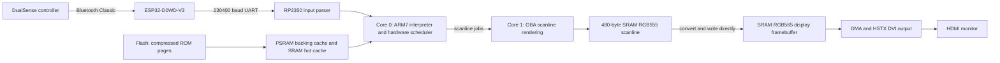

# Game Boy Advance on an Adafruit Feather RP2350

An educational hardware experiment: emulate a Game Boy Advance on an **Adafruit Feather RP2350 with 8 MiB PSRAM**, use a **Sony DualSense controller through an ESP32 Bluetooth bridge**, and display the game through the Feather's **HSTX ribbon connector and DVI adapter connected to an HDMI monitor**.

This project grew from a simple question: can I read every controller value on an ESP32? It became a UART bridge, an HDMI input viewer, a memory and video debugging exercise, and finally a running GBA interpreter on the Feather. This repository documents the working pieces, the failed attempts, and the limits of the current result.

**Latest board-measured build: V45, 20 October 2026.** Sonic runs with
DualSense input and HSTX output, but slow gameplay remains around **7 FPS**.
The latest 45.6-second retained window measures **7.24 FPS**, Run **131.48**,
Draw **35.76** and Wait **14.70 ms/frame**. About 89% of Run is outside explicit
renderer waiting. The **60 FPS gameplay target remains unmet**; a 60 Hz monitor
signal is not 60 emulated FPS.

Seven V45 captures contain 2,213 unique frames after removing overlap, covering
185.672 seconds at a weighted 11.92 FPS across different retained scenes. Faster
entry/menu windows do not establish smooth gameplay. There is no controlled
same-scene V44/V45 speedup measurement. Read the [V45 board analysis](docs/v45-board-results.md).

V46 is now a **packaged local CPU-fetch/profile trial**, with exact native
regressions and firmware checks passed; V45 remains the latest board-measured
build. The full mapped PC histogram preserves the functions that older logs
omitted. Host fetch timings are modest and mixed; no board gain or 60 FPS result
is established. Read [the V46 trial and A/B commands](docs/performance-v46.md).
The modified core and private assets remain excluded.

The workspace began on **18 October 2026 at 22:50:09 Dublin time**; its first
surviving original sketch was created at **22:54:53**. The [history](docs/development-history.md)
distinguishes folder, session, first-code and emulator-subfolder timestamps.

## Read the development story

- [Architecture](docs/architecture.md): boards, data flow, CPU cores, timing, caches, memory and video.
- [Complete development history](docs/development-history.md): from controller experiments through V45 and the unfinished V46 investigation, including failed builds.
- [Debugging guide](docs/debugging.md): how black screens, allocator failures, startup stages and apparent game stalls were investigated.
- [Validation and current state](docs/validation.md): what passed, what was measured on hardware, and what remains unproven.
- [Build and wiring guide](docs/building.md): reproducible support-sketch setup and the prerequisites for the private emulator build.
- [AI development metrics](docs/ai-project-metrics.md): auditable token/time counts, API cost estimates and reproducible JSON/CSV.
- [Memory layout](docs/memory-layout.md) and [interactive treemap source/UX](docs/memory-explorer.md).
- [Binary USB logging](docs/debug-log-v41.md), [on-board PC sampling](docs/profiling-v31.md), and [renderer profile fields](docs/profiling-v40.md).
- [Third-party provenance and publication boundaries](THIRD_PARTY_NOTICES.md).
- [Text evidence](docs/evidence/README.md): build summaries, hardware reports and native test logs through V45, with explicitly labeled V46 work in progress.
- [Core audit, v27](docs/core-audit-v27.md): reproduced Thumb transfer bugs, fetch/timer work and remaining accuracy gaps.
- [Performance and profiling, v28](docs/performance-v28.md): video writes, caches, PSRAM/IRQ measurement, acceleration candidates and proposed PC sampling.

## Architecture at a glance



The ESP32 handles Bluetooth and sends controller reports. The RP2350 does the emulation, rendering and video output. No game data is stored on the ESP32, and UART does not carry ROM pages or video. There is no SD card in the tested setup.

## Hardware

| Part | Role / tested configuration |
| --- | --- |
| Adafruit Feather RP2350 HSTX | Emulation and video; 8 MiB flash and 8 MiB PSRAM in this setup |
| ESP32-D0WD-V3, revision 3.1 | Bluetooth Classic controller bridge; 4 MiB flash detected |
| Sony DualSense | Wireless input |
| Matching 22-pin HSTX FPC cable and HSTX-to-DVI adapter | Connect Feather to monitor through an HDMI cable |
| USB power and common ground | Power both boards and establish UART reference |

| ESP32 connection | Feather connection |
| --- | --- |
| GPIO25 / UART TX | RX / GPIO1 |
| GND | GND |

Use 3.3 V UART logic. Initial testing powered each board separately by USB without connecting their power pins. The link is one-way at **230400 baud, 8N1**.

## Controller pipeline

The ESP32 retains the complete 78-byte Bluetooth input report rather than printing a stream of human-readable values. A bounded one-item FreeRTOS queue transfers the newest report from the Bluetooth callback to the UART sender. The sender transmits at up to 100 Hz using COBS framing and CRC-16/CCITT-FALSE.

The Feather validates framing, packet size, version, flags, report ID and CRC. It clears controls after a disconnect report or 250 ms without valid packets. The GBA frontend also latches short button edges across a complete guest frame because a game running at 7 FPS polls much less often than the controller updates.

| DualSense | GBA |
| --- | --- |
| Cross | A |
| Circle | B |
| D-pad or left stick | Directions |
| L1 / R1 | L / R |
| Options | Start |
| Create | Select |

The diagnostic receiver can show sticks, buttons, triggers, touch contacts, raw motion sensors and battery/status fields. The emulator uses only the mapped GBA controls.

## Current emulator state

| Area | State |
| --- | --- |
| Hardware startup | V45 confirmed by valid board captures; earlier intermittent video recovery remains documented |
| Game tested in current build | Sonic Advance 3, European version; supplied locally, not distributed |
| Earlier game | Super Mario Advance 3: Yoshi's Island, European version |
| Execution | Cycle-scheduled ARM/Thumb interpreter, not a native game port or dynamic recompiler |
| CPU cores | Core 0: interpreter, scheduling, UART, HUD and video IRQ; core 1: scanline rendering and direct RGB565 output |
| Video | 240x160 game image centered in a 320x240 RGB565 buffer; 640x480/60 Hz DVI-compatible output |
| Measured speed | Latest slow V45 capture 7.24 FPS over 45.6 retained seconds; full-speed play remains unresolved |
| VBlank accelerator | Active for recognized event-bounded polling loops; bypassed guest cycles are not host utilization |
| ROM storage | Independently compressed pages in Feather flash, decoded on demand into PSRAM |
| Saves | EEPROM/SRAM/Flash emulation; volatile RAM only, no persistence after reset |
| Sound | No audio output; silent APU mode preserves relevant register/FIFO/event behavior |
| Rendering | Direct scanline output; repeated writes avoid joins/invalidation; one display buffer can tear; no intentional frame skipping |
| Compatibility | Experimental; no claim of complete gameplay or original-hardware accuracy |

The V45 native test completed **6000 emulated frames** with matching CPU/banked state, exact guest cycles, bus/prefetch/latch state, RAM and every converted RGB565 pixel/display margin between accelerated/compressed/threaded execution and an ordinary synchronous/original-ROM path with conservative video invalidation. It also replaces the display allocation at frame 3000. These paths share the emulator core. Agreement is useful regression evidence, not proof that both are correct against a real GBA.

## Performance history at a glance

The V24–V28 entries are user reports with unspecified scene/duration; V45 is a retained binary capture. Times are ms/frame; `—` means not supplied. The v25 identification is inferred from the build sequence, not explicitly named in that report.

| Build | FPS | Run | Draw | Copy | Wait | Main work |
| --- | ---: | ---: | ---: | ---: | ---: | --- |
| v24 | about 5 | — | 46 | 10 | — | Event-bounded VBlank polling acceleration |
| v25, inferred | about 6 | 144 | 37 | 10 | — | Interpreter helper inlining and SRAM ROM-hit callbacks |
| v26 | 6-7 | — | 49 | 0 | 26 | Core-1 direct video output; full-frame copy removed |
| v27 | about 7 | 121 | 33 | 0 | 32 | Thumb correctness fixes, specialized fetches and cached timer deadlines |
| v28 | about 7 | 113 | 22 | 0 | 14 | Unchanged-write suppression and selective tile-cache invalidation |
| V45 slow capture | 7.24 | 131.48 | 35.76 | ~0 | 14.70 | Packed renderer math; native PC sampling and per-frame binary evidence |

V28's scripted native run found 4,141,934 of 4,196,721 video writes unchanged. Decoded tile-row cache misses fell from 8,011,631 to 3,848,078, while almost all scanlines still rendered. Those work counts are not hardware speedup percentages. Read the [full history](docs/development-history.md) for earlier 1-5 FPS builds, black-screen failures and subsequent corrections.

## What is published here

This is a **development record and original support-code repository**, not a complete downloadable emulator release.

The local experiment adapts [`gba-embedded`](https://github.com/bhoot1234567890/gba-embedded) at commit `4ddb79e60f20979b8e438dfa00bf1c71a4a5a289`. Its README explicitly states that it grants no licence to copy, modify or redistribute the code. The modified CPU, bus, PPU and other core sources under `GBAPrototype/GBAFeather/src/core/` and `src/gba/` are therefore **excluded from this publication**. The repository's GPLv3 file does not grant rights to that absent upstream code.

Included: original controller/UART code, HDMI and PSRAM diagnostics, emulator integration/support files, the ROM packer, test harnesses, provenance and development documentation. The controller viewer and standalone hardware tests can be built independently. The GBA frontend and its native tests require the separately held modified core and locally generated ROM assets; **a fresh clone cannot build the v28 emulator as-is**. Upstream alone also lacks this project's private changes.

No commercial ROM, compressed game payload, game screenshot, ROM-containing UF2, compiled emulator binary or archived core source is uploaded. Game titles and numerical test results identify the experiments without distributing game data. See [publication boundaries](THIRD_PARTY_NOTICES.md) before using or extending this repository.

## Repository map

```text
DualSenseReader/       ESP32 Bluetooth-to-UART sender
FeatherReceiver/      Standalone controller-to-HDMI viewer
HDMITest/             Basic HSTX video test
HDMIPSRAMTest/        Early combined video/memory diagnostic
HDMIPSRAMSafeTest/    Staged clock/memory diagnostic
PSRAMDirectTest/      Direct mapped-memory test separated from allocator test
GBAPrototype/
  GBAFeather/         v28 frontend and original support files; core excluded
  tools/             ROM packer and private-reference preparation tools
  tests/             Native test harness; requires excluded core and local assets
  linker/            16 KiB main-stack linker layout and SDK licence
docs/                 Architecture, chronological history, debugging and evidence
Emulator Development/ Existing reference documents retained from main
```

## Where development can go next

Board PC sampling, renderer phase timing, PSRAM benchmark loops and USB binary
capture are now implemented. Recent logs place CPU dispatch/fetch ahead of explicit
renderer waits. The next work examines the full execution/bus/scheduler path and
more complete native/guest workload profiles, with controlled same-scene board
A/B runs. V46's cached-fetch leaf is a board-trial candidate, not a demonstrated solution. Its first host comparison is modest/mixed, including a later-scene
regression. Native JIT translation, DWT/XIP/bus attribution and a new scanout
backend remain unimplemented proposals. The 60 FPS target is the acceptance
criterion, not a claimed result.

Before a complete public emulator release, the core needs redistribution permission or replacement with a suitably licensed implementation. Save persistence, sound, broader game compatibility and stable gameplay also remain open work.

This repository was prepared on the `develop` branch for educational writing. The version names describe actual local build iterations; they are not fabricated historical Git commits. Documentation and code were developed with AI coding assistance and hardware feedback from the project author.
