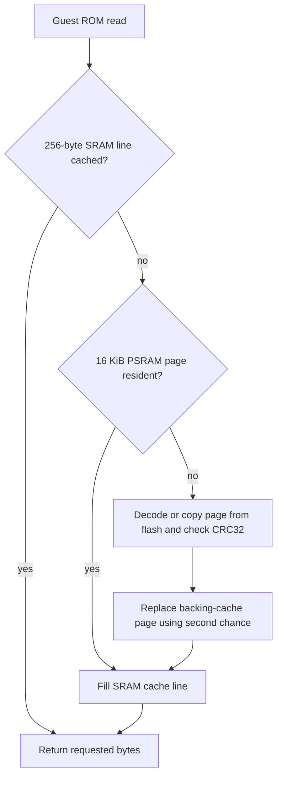

# Architecture of the RP2350 GBA experiment

This describes the local **v28** implementation, including the excluded emulator core. The original frontend and hardware support files are published; core implementation details are documented without redistributing its sources. See [publication boundaries](../THIRD_PARTY_NOTICES.md).

## Three different timing domains

It helps to distinguish controller sampling, guest execution and monitor refresh. Bluetooth reports arrive independently of emulation. UART forwards the newest report at up to 100 Hz. The GBA interpreter advances a guest cycle counter at the modeled hardware rate, but it can take much longer than one real second to emulate one guest second. HSTX continues generating a 60 Hz monitor signal from the last framebuffer throughout that work.

The guest model uses 16,777,216 cycles/second, 1232 cycles/scanline and 228 scanlines/frame: 280896 cycles per frame, or about 59.73 guest frames per second at full speed. At 7 completed guest frames per wall-clock second, the game runs far below real-time. The HUD FPS counts completed emulated frames rather than HDMI refreshes.

## Controller acquisition on ESP32

The tested ESP32 is an ESP32-D0WD-V3, revision 3.1, with Bluetooth Classic and 4 MiB flash. It uses the `HamzaYslmn/esp-ps5` library and specifically its `latestPacket` API.

The Bluetooth callback copies a 78-byte report and timestamp into a fixed one-item FreeRTOS queue using overwrite semantics. It does not write UART, print diagnostics or wait. The main loop takes the newest report, checks controller connection and a 100 ms freshness timeout, and sends it at intervals of at least 10 ms. Intermediate samples may be replaced; this is a latest-state transport rather than a lossless event recorder. Offline heartbeats are sent every 100 ms. UART transmission begins only if the full frame fits in the transmit buffer.

The retained report covers digital buttons, sticks, analog triggers, touch contacts, raw gyro/accelerometer readings and battery/status fields. Microphone audio, feature reports and factory sensor calibration are outside this input stream.

## UART wire format

See the identical `UartProtocol.h` copies in the sender, diagnostic receiver and GBA frontend.

| Decoded byte offset | Length | Meaning |
| --- | --- | --- |
| 0 | 1 | Protocol version: 1 |
| 1 | 1 | Controller online: 1 or 0 |
| 2 | 2 | Wrapping sender sequence, little-endian |
| 4 | 78 | Complete input report; zero-filled when offline |
| 82 | 2 | CRC-16/CCITT-FALSE over bytes 0-81, little-endian |

CRC parameters are polynomial `0x1021`, initial `0xffff`, no reflection and no final XOR. COBS encodes the 84-byte packet and a zero byte delimits it. A wire frame is 86 bytes, taking about 3.73 ms at 230400 baud with 8N1. At 100 Hz that occupies approximately 37% of the line capacity.

The receiver rejects oversized frames, incorrect COBS lengths, bad versions/flags/report IDs and CRC failures. A delimiter lets it resynchronize after corruption. Sequence resets following an ESP32 reboot are accepted. The GBA sketch uses a 4096-byte UART FIFO and polls between guest execution slices of roughly 1024 cycles. Those slices are guest time, not a bound on wall-clock input latency.

Disconnect or 250 ms without a valid packet clears input. `FrameInputLatch` holds a newly pressed GBA bit until at least two frame-number transitions after its arrival, guaranteeing an intervening complete guest frame. Physical holds remain held. Closely spaced taps can merge at low FPS; this compensates for missed polls but does not make slow emulation responsive.

## Emulated machine and event scheduler

The local core is a C++20 ARM7TDMI interpreter with ARM and Thumb dispatch, banked registers, flags, exceptions and modeled bus timing. It is not executing the ROM as native Cortex-M33 code. RP2350 being an Arm chip does not make an ARM7 GBA binary directly compatible with the microcontroller's instruction mode and hardware.

The emulator owns CPU, bus, cartridge, PPU, APU, timers, DMA, serial model and IRQ state. The scheduler runs the CPU only up to the earliest hardware event or requested slice boundary, then services due hardware. Memory accesses route through the bus for RAM, ROM, display memory and MMIO. Guest writes and DMA can affect video memory or scheduled interrupts; an optimization must preserve their ordering.

Boot uses a Cult-of-GBA replacement BIOS. Earlier HLE-only boot did not boot the initial ROM correctly. There is also cartridge save-type detection and an added serial EEPROM path supporting 6- and 14-bit addressing. Save data is not written back to persistent storage in the present frontend.

## Work split across the RP2350 cores

| Execution context | Work |
| --- | --- |
| Core 0 main loop | ARM7 interpretation, guest hardware scheduling, UART input, HUD and frame accounting |
| Core 0 video IRQ | Original Adafruit HSTX DMA handler, wrapped with completion and handler-time counters |
| Core 1 | GBA scanline rendering into a 480-byte SRAM row, RGB565 conversion and direct display writes through a release/acquire mailbox |

The worker permits one pending scanline. Core 0 can overlap unrelated CPU work with core 1 drawing. Changed palette/VRAM/OAM writes, video-register accesses, relevant DMA operations, reset and frame completion retain synchronization. Core 0 is the sole memory writer; core 1 only reads those arrays. V28 can compare an effective stored video-memory value while a job is pending: an identical value needs no store, join or dirty/cache mutation. A changed value still joins before shared memory changes. Guest timing/access bookkeeping is retained in both cases.

The worker joins previous work before checking dirty flags; clean rows keep their existing display pixels. Frame completion drains pending work. HDMI recovery drains and detaches the worker before freeing the display allocation, restores backed-up pixels and rebinds the new target. Core 1 has an explicit 8 KiB SRAM stack and 64-byte canary. The legacy PPU framebuffer allocation remains but is stale during direct output; captures must use the actual display path.

Neither core has a measured complete busy/stall/idle utilization profile yet. This split does not double emulator speed: CPU interpretation remains serial, memory and video resources are shared, and synchronization limits overlap. The old `C1` counter counted completed scanline jobs, including unchanged lines, and did not prove that game logic or visible pixels were advancing.

## Storage and on-demand decompression

A generic GBA image may be larger than the Feather's flash. The project first considered storing it on the ESP32 and transferring it by UART. The final design stores the game only in Feather flash and compresses it before the build. The entire image need not fit uncompressed in PSRAM.

`tools/pack_rom.py` splits a local ROM into independent **16 KiB raw-DEFLATE pages**. If a page grows under compression, it is stored raw. An index records packed offset, packed size, uncompressed length, CRC32 and raw/compressed flag. The packer reconstructs the complete image and checks it against the input before producing generated files.

The current backing cache is fully associative with a page-to-slot lookup and second-chance replacement. It holds **440 pages**, or 7208960 bytes. This replaced a much smaller direct-mapped cache that suffered conflicts. A separate **32 KiB, two-way SRAM cache with 256-byte lines** serves hot instruction/data reads. CRC checks detect corruption on decode; startup also verifies resident pages after filling the large cache to exercise retention across the PSRAM region.

| Private test image | Original bytes | Packed page payload |
| --- | ---: | ---: |
| Super Mario Advance 3: Yoshi's Island EU | 8388608 | 3033341 |
| Sonic Advance 3 EU | 16777216 | 4753067 |

Compression is content-dependent. Passing the packer's 32 MiB input-size limit does not guarantee a complete firmware image will fit 8 MiB flash. Linker and UF2 bounds must also pass. No ROM bytes or generated ROM files are published here.

## Memory placement

PSRAM provides capacity; internal SRAM provides lower-latency access. The port deliberately puts frequently accessed GBA IWRAM, VRAM, palette and OAM in internal SRAM, even though their names describe guest hardware rather than physical RP2350 memory types.

| Internal SRAM allocation | Size / purpose |
| --- | --- |
| Static fast bus storage | 133184 bytes: IWRAM 32 KiB, VRAM 96 KiB, palette 1 KiB, OAM 1 KiB, wait tables 64 bytes |
| Hot ROM line cache | 32768 bytes |
| HDMI buffer | 153600 bytes, allocated at runtime |
| Main stack | 16384 bytes reserved by local linker layout |
| Renderer stack | 8192 bytes plus 64-byte canary |
| Replacement BIOS, core state, renderer caches and hot code | Additional runtime/linked SRAM use |

These categories are not additive to the compiler's static-SRAM total: some are already included in it, while others are runtime allocations. V28 reports **227108 static bytes** and **280788 bytes between `__end__` and `__HeapLimit` before dynamic allocations**, with the main stack reserved above that. This is not a runtime free-heap measurement.

| Fixed PSRAM arena allocation | Bytes |
| --- | ---: |
| Video recovery backup | 153600 |
| Decoded ROM cache | 7208960 |
| Legacy GBA framebuffer, retained but stale during direct output | 76800 |
| GBA EWRAM | 262144 |
| Reusable maximum save reservation | 131072 |
| **Used** | **7832576** |
| Arena capacity | 7864320 |
| Spare in arena | 31744 |

The arena occupies 7.5 MiB and leaves a separate 512 KiB outside it for the SDK. Its allocation cursor lives in SRAM. It uses bounded, 16-byte-aligned, fixed-lifetime allocations, avoiding the external allocator path implicated during bring-up. Individual frees do nothing on hardware; repeated teardown/recreation is not supported.

## HSTX and presentation

The working frontend uses `DVHSTX16` with a 320x240 RGB565 framebuffer. The driver generates 640x480/60 Hz DVI-compatible video over the HSTX adapter's HDMI connector. There is no HDMI audio.

Since v26, core 1 renders each dirty 240-pixel RGB555 scanline into 480 bytes of SRAM, converts it to RGB565 and writes it into the display rectangle at `(40,48)`. This bypasses the old PSRAM framebuffer write/read round trip and core-0 full-frame copy. Conversion/presentation now contributes to Draw. Copy near zero does not mean pixel conversion disappeared. The game aspect ratio is preserved. A single display buffer can tear while HSTX scans it.

HSTX uses DMA channels 0-2 in the tested library configuration and invokes a per-scanline interrupt at roughly 31400-31500 calls/second in user reports. The original handler performs video work as well as acknowledging IRQs. The wrapper preserves the original handler. V28 counts completions and adds handler time in `ms/s`, excluding some entry/exit/wrapper overhead and adding two timer reads per IRQ. The original handler still expands 320-pixel source rows to 640 output pixels in software. Its measured time has not yet been supplied; IRQ rate alone does not establish utilization.

The emulator sets the CPU to **240 MHz** and PSRAM to **30 MHz**, preserving the separate video clock. The memory timing code runs from SRAM, applies the slower memory divisor before increasing CPU speed, and uses legal QMI field values. The build retains a 16 KiB main stack and distinct scratch-memory placement for the video handler.

## V24's VBlank wait acceleration

Native instruction sampling located Sonic repeatedly reading DISPSTAT's VBlank status. A strict recognizer extends the earlier RAM-poll accelerator to a five-instruction Thumb pattern: load halfword, copy mask, AND, compare with zero, and a taken BEQ/BNE back to the load. All involved low registers must be distinct. Only **address `0x04000004`, mask `1`** is accepted for MMIO; other MMIO/status masks are rejected.

Acceleration requires repeated stable CPU registers, flags, bus/prefetch/latch state, fetch age and loop period. It advances only whole redundant iterations before the next scheduled hardware event, retains a normal-execution tail and preserves the interpreter's timer-service instruction phase. It changes neither ROM data nor guest frame timing and does not skip rendering frames.

The 6000-frame native test bypasses 347342144 of 1685292894 guest cycles, or **20.61%**. The board's latest v28 `VBskip` report is **12%**, with about **7 FPS**. `VBskip` measures guest cycles bypassed during the HUD interval; it is not CPU idle time, speedup or a promise of full-speed emulation.

## Interpreter and memory-path work through v28

V25 inlines small unchanged IRQ/deadline/halt/prefetch helpers and moves three hot ROM-cache callbacks into SRAM. The inspected interpreter loop's static call sites fell from 20 to 12; that compiler observation is not a proportional FPS claim.

V27 specializes common instruction fetches while keeping ordinary bus fallback for special cases. It returns value/cycles in a scalar instead of the general data-access result and caches the next timer deadline, with an inline guard before entering the large event handler. Independent nonempty Thumb-transfer tests also exposed and fixed LDMIA/STMIA base-in-list behavior. Those exceptional cases were not reached by the scripted Sonic sequence. See the [core audit](core-audit-v27.md).

V28 avoids dirty marking for unchanged storage display-register writes without changing the existing register merge/flag model. Small changed physical VRAM ranges invalidate only overlapping decoded 4bpp/8bpp row-cache slots; large or unknown changes use the conservative epoch path. A real video change still marks all scanlines dirty. Fast VRAM DMA compares values, aggregates changed physical bytes and invalidates once after a joined burst. Scalar stores and the SRAM source helper avoid per-unit flash calls. In-range generic bus helpers avoid runtime modulo.

The native sequence still submits 958723 worker jobs across 6000 frames, nearly all visible rows. The improvement targets redundant stores/joins and tile decoding; it does not eliminate most rendering. Guest timing, ROM data and frame count are preserved.

## Measurement facilities and open questions

V28 startup stage 13 measures existing SRAM IWRAM and PSRAM EWRAM before guest reset, without an extra memory allocation. It times 131072 32-bit operations per column: sequential reads, dependent pointer-chain reads, sequential writes and scattered writes. The table compares SRAM 32 KiB, PSRAM 32 KiB and PSRAM 256 KiB, then remains visible for 15 seconds. Results include cache, loop and live HDMI interrupts; they are not isolated raw-chip latency or simultaneous emulation/rendering measurements. The normal reset clears the test buffers before executing guest code.

PSRAM access, CPU decoding, flash helper calls, synchronization and HDMI work can all contribute. Zero software ROM-page misses says nothing by itself about PSRAM working-RAM stalls or physical XIP-cache misses. UART uses about 8.6 KB/s at its maximum report rate and its polling is bounded; its parsing/ISR cost has not been separately measured. Low guest FPS also delays input processing independently of UART delivery.

The [performance and profiling record](performance-v28.md) separates the implemented benchmark/IRQ timer from proposed per-core PC sampling, DWT and bus counters, controlled tests, decoded instruction caching, dynamic recompilation, interpolator use and DMA scanout redesign. None of those proposals has an established speedup. Latest v28 hardware: Run 113, Draw 22, Copy 0, Wait 14 ms/frame, about 7 FPS. Wait belongs to Run and Draw overlaps Run; these are not additive utilization measurements.
